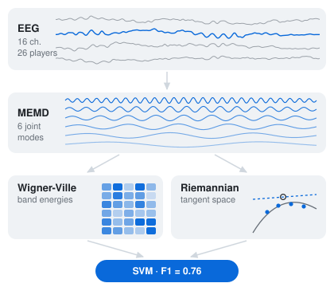
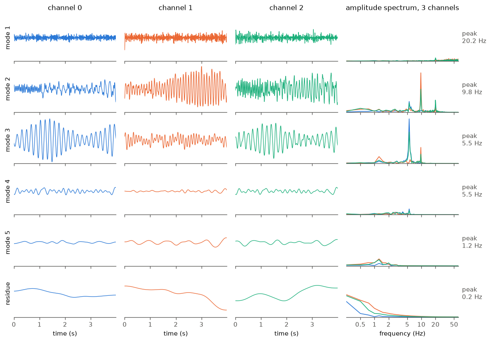
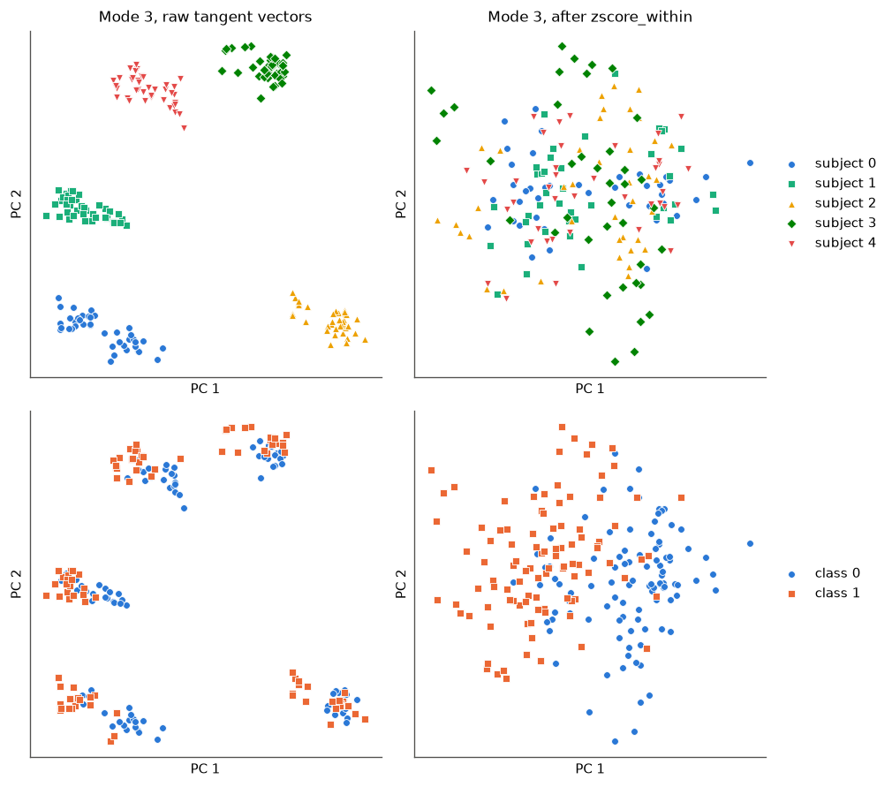

# flow-state-uqam

<p align="center">
<picture>
  <source media="(prefers-color-scheme: dark)" srcset="assets/pipeline-dark.svg">
  
</picture>
</p>

Code for **EEG decoding of in-game attentional engagement**: multivariate empirical mode decomposition, Wigner-Ville band energies and per-mode Riemannian geometry, evaluated leave-one-subject-out.

Louis Almairac, Mounir Boukadoum. *EEG Decoding of In-Game Attentional Engagement.* Submitted to IEEE ISCAS 2027. Research internship at UQAM (MicroPro lab, Montréal), 2026.

## The study

26 skilled players, about 4 hours of *Apex Legends* each, recorded at Ubisoft La Forge with a 16-channel EEG headset (OpenBCI, 125 Hz). Flow state has no ground truth, so the labels come from behaviour: small targets appeared at the edge of the screen and players pressed a button when they saw one. A long run of missed targets marks a player fully absorbed in the game; lobby rest between matches is the contrast.

Absorbed play vs. rest decodes well across subjects (macro-F1 = 0.76, leave-one-subject-out), on par with an end-to-end EEG-Conformer. Control analyses (eye-tracking, within-subject permutation tests, self-supervised probes) show what the model reads: a broad play-vs-rest arousal shift rather than a marker of flow itself, hence the framing as attentional engagement.

The recordings belong to the Ubisoft La Forge study and are not public. This repository contains the method, a synthetic data generator to run it end to end, and tests.

## The method

| Step | What it does | Code |
|---|---|---|
| Multivariate EMD | Sifts all channels jointly along 32 directions of the sphere, with cubic-spline envelopes and mirror extension at the edges, so that mode *k* has the same scale on every channel. | `flowstate.memd` |
| Wigner-Ville band energies | Pseudo Wigner-Ville distribution of each mode, mean energy in 5 bands (delta to gamma): 6 × 5 = 30 features. | `flowstate.wigner_ville`, `band_energies` |
| Per-mode covariances | Ledoit-Wolf covariance across channels for each mode, one SPD matrix per mode. | `flowstate.mode_covariances` |
| Tangent space | Each mode's matrices are mapped to the tangent space at their Riemannian mean, learned on the training subjects only. | `flowstate.FusedClassifier` |
| Classifier | Both feature sets are z-scored within each subject and fused in an RBF SVM. | `flowstate.FusedClassifier` |
| Evaluation | Leave-one-subject-out, and a permutation test that shuffles labels within each subject. | `flowstate.loso`, `permutation_test` |

Everything in `extract` is computed segment by segment, without labels, so features can be cached before cross-validation without leakage.

## Quick start

```bash
git clone https://github.com/luchocomputor/flow-state-uqam
cd flow-state-uqam
pip install -e .
python examples/demo_synthetic.py
```

```
240 segments, 8 channels, 500 samples, 6 subjects
features: WVD (240, 30), covariances (240, 6, 8, 8) (10 s)
wvd      LOSO macro-F1 = 0.871
riemann  LOSO macro-F1 = 0.900
fused    LOSO macro-F1 = 0.925
permutation test (wvd): F1 = 0.871, null = 0.505, p = 0.020
```

On your own data, segments of shape `(n_segments, n_channels, n_times)`, already band-pass filtered:

```python
import flowstate as fs

feats = fs.extract(X, sfreq=125.0)            # MEMD, WVD energies, per-mode covariances
res = fs.loso(lambda: fs.FusedClassifier(), feats, y, groups)
print(res["f1"], res["per_subject"])

perm = fs.permutation_test(lambda: fs.FusedClassifier(), feats, y, groups, n_permutations=500)
print(perm["p_value"])
```

`groups` holds the subject of each segment. `FusedClassifier(use="wvd")` and `use="riemann"` run each branch alone.

## Notebook

[](https://colab.research.google.com/github/luchocomputor/flow-state-uqam/blob/main/notebooks/demo.ipynb)

[`notebooks/demo.ipynb`](notebooks/demo.ipynb) shows what each step does on synthetic data: the modes, the Wigner-Ville map, the tangent space before and after per-subject z-scoring, the leave-one-subject-out scores and the permutation test. It runs in under two minutes on a laptop.

```bash
pip install -e ".[notebook]"
jupyter lab notebooks/demo.ipynb
```

<p align="center">

</p>

MEMD of one synthetic segment: within a row, the three channels share the same spectral peaks.

<p align="center">

</p>

Tangent vectors of mode 3 (PCA, synthetic data): one cluster per subject before per-subject z-scoring (left), classes separated after (right).

## Tests

```bash
pip install -e ".[dev]"
pytest
```

The tests check that the modes add up to the signal, that MEMD puts the fast oscillation in the first mode, that the Wigner-Ville frequency axis is right, and that the pipeline beats chance on synthetic data.

## License

MIT, see [LICENSE](LICENSE).
